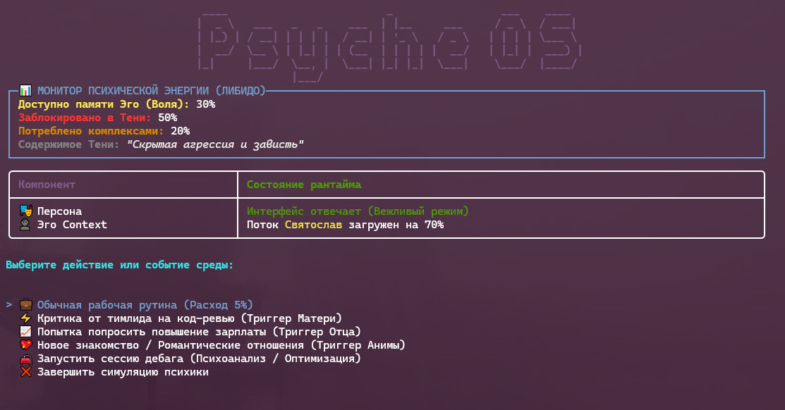

# 🧠 PsycheOS

**PsycheOS** — это экспериментальный движок, моделирующий аналитическую психологию К. Г. Юнга через призму объектно-ориентированного программирования на **.NET 8.0/9.0** с интерактивным дашбордом на `Spectre.Console`.

> *«Пока вы не сделаете бессознательное сознательным, оно будет направлять вашу жизнь, и вы назовете это судьбой.»* — К. Г. Юнг (и лог дебаггера PsycheOS).

---

## 📖 Оглавление Архитектуры (Карта Психики)

Этот репозиторий спроектирован как живой учебник. Ниже представлены ссылки на подробную документацию каждого компонента системы:

### 1. Ядро Системы (The Core)

* [IndividualMind.cs](./src/IndividualMind.cs) — Центральный процессор психики. Управляет пулом психической энергии (`Libido`), накапливает стресс и координирует архетипы.
* [Psychoanalyst.cs](./src/Psychoanalyst.cs) — Инструмент глубокого дебага. Использует `System.Reflection` для обхода инкапсуляции и ручной перезаписи приватных полей Тени.

### 2. Базовые Архетипы (Abstract Classes & Interfaces)

* [Архетип (Archetype.cs)](./docs/archetypes/Archetype.md) — Абстрактный класс, определяющий базовый жизненный цикл психического паттерна и метод `ProcessTrigger`.
* [Персона (IPersona.cs)](./docs/archetypes/Persona.md) — Публичный интерфейс (`public interface`). То, как наша программа взаимодействует с внешним рантаймом (социумом).
* [Тень (Shadow.cs)](./docs/archetypes/Shadow.md) — Инкапсулированное состояние (`private field`). Хранилище вытесненных данных, недоступное для стандартных методов.

### 3. Автономные Комплексы (Implementations)

* [Материнский Комплекс (MotherComplex.cs)](./docs/complexes/MotherComplex.md) — Наследник Архетипа. Перехватывает критику, генерирует аффективный красный лог в консоль и сжигает Libido.
* [Отцовский Комплекс (FatherComplex.cs)](./docs/complexes/FatherComplex.md) — Цензор амбиций. Вызывает эксепшен синдрома самозванца через макрос `[[ЦЕНЗУРА ОТЦА]]`.
* [Анима / Анимус (AnimaProxy.cs)](./docs/complexes/AnimaProxy.md) — Паттерн *Proxy*, перехватывающий романтический контекст и подменяющий реальные объекты идеализированными структурами данных.

---

## 🛠 Технологический Стек

* **Платформа:** .NET 8.0 / .NET 9.0 (C# 12/13)
* **Интерфейс:** `Spectre.Console` (рендеринг таблиц, панелей и аффект-логов в реальном времени)
* **Паттерны проектирования:** Proxy, Singleton, Command, Reflection Injection

## 🚀 Быстрый старт

1. Склонируйте репозиторий.
2. Запустите проект через CLI:

   ```bash
   dotnet run --project src/PsycheOS.csproj
   ```

3. Откройте интерактивное меню и попробуйте пропустить жизненное событие через `IndividualMind`. Следите за уровнем аффекта!

